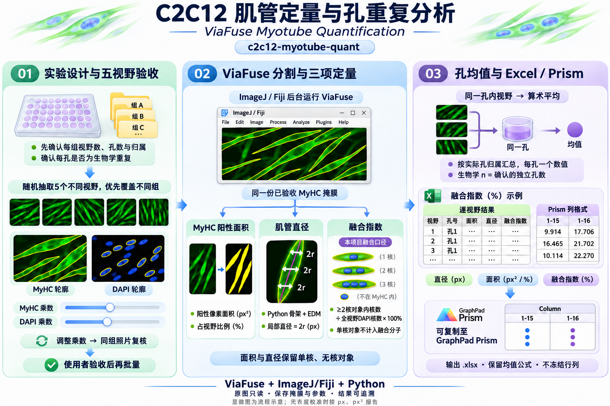

# C2C12 Myotube Quantification

C2C12 肌管定量与孔重复分析：**五视野轮廓验收 → ViaFuse / ImageJ 分割 → 面积、直径与融合指数 → 孔均值 → Excel / Prism 列格式**。

可安装到 **Claude Code 和 Codex**。本地科学计算流程已在 Windows + Fiji/ImageJ + Python 环境验证。



## 安装到 Claude Code 和 Codex

安装 Node.js 22.20+ 后，运行以下命令，同时安装到两个客户端：

```bash
npx skills add https://raw.githubusercontent.com/BoBolol-CN/c2c12-myotube-quant/main/c2c12-myotube-quant.zip -g -a claude-code codex --copy
```

只安装其中一个客户端：

```bash
# Claude Code
npx skills add https://raw.githubusercontent.com/BoBolol-CN/c2c12-myotube-quant/main/c2c12-myotube-quant.zip -g -a claude-code --copy

# Codex
npx skills add https://raw.githubusercontent.com/BoBolol-CN/c2c12-myotube-quant/main/c2c12-myotube-quant.zip -g -a codex --copy
```

安装采用 [Vercel Skills CLI](https://github.com/vercel-labs/skills)。PowerShell 只是可使用的终端，不是所需的 AI 客户端；`--copy` 避免 Windows 符号链接权限问题。

也可下载 [完整 skill ZIP](c2c12-myotube-quant.zip)，将其中的 `c2c12-myotube-quant` 文件夹放入：

- Claude Code：`~/.claude/skills/`
- Codex：`$CODEX_HOME/skills/`，未设置时为 `~/.codex/skills/`

安装后新开会话，Claude Code 使用 `/c2c12-myotube-quant`，Codex 使用 `$c2c12-myotube-quant`，附上图片目录和需求。安装 skill 不会自动安装 Fiji、Python 或 GraphPad Prism。

## 工作流

1. **先确认实验设计。** 计算前询问每组的视野数、孔数、视野与孔的对应关系，以及每孔是否为一个生物学重复。没有固定的“9视野/3孔”默认值。
2. **随机五视野试跑。** 优先覆盖五个不同组；组数不足时覆盖全部组后补足不同视野。调整参数仍复核同一组照片。
3. **分别验收 MyHC 与 DAPI。** 展示纯绿肌管轮廓和纯蓝核轮廓。两通道乘数由本批试跑确定，不固定使用历史参数；使用者确认前不计算三项指标或扩展全批。
4. **原生 ImageJ 后台批处理。** 使用 ViaFuse 作者宏的分割步骤；原图只读。保留实际宏、日志、掩膜、参数和校验值。
5. **同一 MyHC 掩膜计算三项指标。** 面积、直径和核归属共用同一套已验收掩膜，Python 不重新分割。
6. **按孔汇总。** 每孔取其所属视野指标的算术平均；融合指数先逐视野计算再平均。只有经确认的独立孔才作为生物学重复。
7. **交付 Excel。** 左侧逐视野结果与孔号，右侧分别给出直径、面积和融合指数的 Prism Column 数据，每个孔一个数值；保留均值公式，不冻结行列。

## 三项指标

| 指标 | 计算方式 | 输出单位 |
|---|---|---|
| MyHC 阳性面积 | 全部 MyHC 阳性像素面积及其占全视野比例 | px²、% |
| 肌管直径 | 同一 MyHC 掩膜的骨架 + 欧氏距离变换，局部直径为 2r；先对象平均，再对对象等权汇总 | px |
| 融合指数 | 含 **≥2 个核**的 MyHC 对象内核数 / 全视野 DAPI 核数 ×100% | % |

核归属依据 DAPI 核质心是否落在对应 MyHC 对象内。单核对象不进入融合分子，但单核、无核对象仍计入面积和直径。没有额外的尺寸/形状筛选，也不做人工核数修正。零核或缺失视野会标记需复核，不填零或静默少算。

融合指数的 ≥2 核标准是本项目口径；Python 骨架 + EDM 直径是本项目扩展，不声称属于 ViaFuse 原版自带或作者认证功能。没有有效长度校准时不换算为 μm、μm²。

## Excel 与 Prism

最终交付 `.xlsx`，而非用 CSV 替代。每个指标区首行为组名，每列下方是对应孔均值。右侧百分比采用 0–100 数值，可复制到 GraphPad Prism 的 Column 表格。

当前版本**不自动生成 Prism 原生工程、统计检验或显著性星号**。介绍图中的显微图为生成的流程示意，表格为匿名编号示例。

## 安装包内容

```text
c2c12-myotube-quant/
├── SKILL.md
├── scripts/
│   ├── validate_manifest.py    # 实验设计、视野/孔数量与两通道验收校验
│   ├── select_pilot.py         # 记录随机种子的五视野抽样
│   ├── run_viafuse.py          # 原生 ImageJ 通道分割与轮廓预览
│   ├── run_batch.py            # 批处理与已有批准掩膜的复用
│   ├── measure_masks.py        # 面积、骨架/EDM直径、≥2核融合指数
│   └── export_excel.mjs        # 孔均值公式、Prism列格式与Excel
├── references/
│   ├── data_contract.md       # 输入manifest与使用者确认记录
│   └── execution.md           # 执行及导出方法
└── assets/viafuse/
    ├── ViaFuse_F_windows.ijm
    ├── ViaFuse_V_windows.ijm
    └── source_manifest.json
```

ZIP 保留完整源码和原版宏，不含实验原图、私人磁盘目录清单或本地分析运行记录。

## 软件与运行环境

- Fiji / ImageJ：通过原生启动器后台执行。已验证 Windows ImageJ 1.52i；可使用 `--imagej` 指定本机路径。
- Python：`numpy`、`scipy`、`scikit-image`、`tifffile`、`Pillow`。
- Excel：自带 JavaScript 导出脚本使用 `@oai/artifact-tool`，按当前 Codex 表格运行库配置执行。安装到 Claude Code 不会附带 Codex 专用工具；其他客户端需配置兼容的表格写入环境或按相同数据口径适配导出，不能把安装成功视为该环境已完整验证。
- 不需要 MATLAB，不使用 MyoCount。Windows 以外的平台与其他 ImageJ 版本需先验证启动方式和掩膜一致性。

## 验证与来源

本版已用 18 个已验收视野回归核对三项指标，用一对原图验证原生 ImageJ 预览掩膜逐像素一致，并验证 24 个孔均值公式及无冻结 Excel 导出。另检查了单核排除、2/3核纳入、无核对象保留和零核复核行为；这些程序验证不等同于证明所有新图像的分割准确率。

ViaFuse 来源：[tasneemsmacros/ViaFuse](https://github.com/tasneemsmacros/ViaFuse)，提交 `40f178768853bb68936e50b2fe48da1dcf9010da`。分割沿用作者宏步骤，原版宏及校验信息保留在安装包中。原版程序权利归其作者；本仓库不对第三方文件重新授权。
